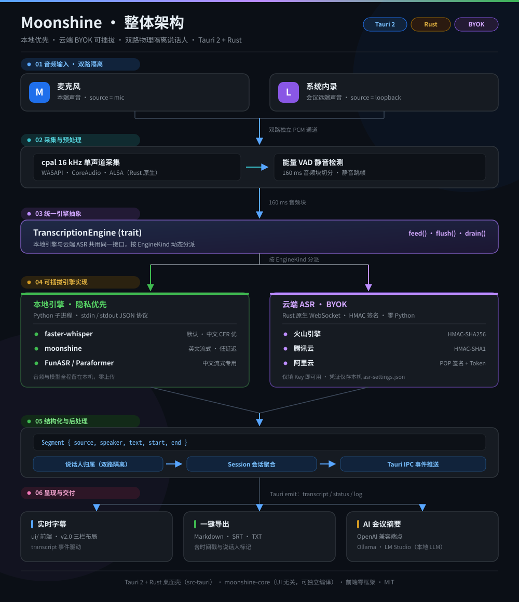

# 🌙 Moonshine — 本地 AI 会议助手

<div align="center">

[](./LICENSE)
[](#)
[](https://tauri.app)
[](https://www.rust-lang.org)
[](https://www.python.org)

**开源免费 · 本地优先 · 云端 BYOK 可插拔 · 隐私零风险**

</div>

---

## ✨ 这是什么

一个**本地优先的跨平台会议转写助手**：同时采集**麦克风**（你的声音）和**系统内录**（对方/会议软件声音），实时转写为带说话人归属的结构化会议记录，支持一键导出 Markdown / SRT / 纯文本，并可调用本地大模型生成会议摘要。

> 会议记录的本质是「让没参会的人获得同等上下文」——不是为了 AI，是为了**可查询、可追溯、可复用**。

---

## 🎯 核心能力

| 能力 | 说明 |
|---|---|
| 🎙️ 双路采集 | 麦克风 + 系统内录并行，物理隔离区分「本端 / 远端」说话人 |
| 🧠 多引擎可插拔 | faster-whisper（中文优先，默认）/ moonshine（英文流式）/ FunASR·Paraformer（中文流式） |
| ☁️ 云端 ASR（BYOK） | 火山引擎 / 腾讯云 / 阿里云，仅需填入 API Key，无需本地模型与 Python |
| ⚡ 低延迟 | 160ms 音频块 + 本地推理，实时字幕无感知延迟 |
| 🔒 隐私可控 | 本地引擎数据零上传；云端引擎仅在显式选择时上传音频 |
| ✨ AI 摘要 | 对接 OpenAI 兼容端点（本地 Ollama / LM Studio），生成结构化纪要 |
| 📁 一键导出 | Markdown / SRT 字幕 / 纯文本，含时间戳与说话人标记 |
| 📖 内置使用指南 | 界面内「接入 / 编译 / 部署」三 Tab 指引，一键打开完整文档 |

---

## 🧱 技术架构

[](assets/architecture.svg)

> 图中**绿色**为本地引擎链路（音频与模型全程留在本机、零上传），**紫色**为云端 ASR 链路（BYOK，仅在显式选择时启用）。点击图片查看大图 · [SVG 源码](assets/architecture.svg)。

- **桌面框架**：Tauri 2 + Rust（包体 ~10MB，内存占用低）
- **音频采集**：`cpal`（WASAPI / CoreAudio / ALSA）
- **转写引擎**：多引擎可插拔，默认 `faster-whisper`（中文 CER 业界领先）
- **云端 ASR**：原生 `tokio-tungstenite` WebSocket 客户端，火山（HMAC-SHA256）/ 腾讯（HMAC-SHA1）/ 阿里（POP 签名 + CreateToken），零 Python 依赖
- **核心库**：`moonshine-core`（UI 无关，可独立编译测试）

> 详细设计见 [`doc/ARCHITECTURE.md`](doc/ARCHITECTURE.md)，选型依据见 [`doc/竞品调研-20261026.md`](doc/竞品调研-20261026.md)。

---

## 📚 文档导航

| 文档 | 内容 | 适合谁 |
|---|---|---|
| [☁️ 接入指导](doc/接入指导.md) | 火山 / 腾讯 / 阿里控制台开通、取 Key、字段对照、测试连接、版本差异与排错 | 使用云 ASR |
| [🛠️ 本地编译指导](doc/本地编译指导.md) | 全平台工具链、分层编译、`cargo tauri dev/build`、常见错误排查 | 开发者 |
| [📦 部署指导](doc/部署指导.md) | 三种部署形态、打包产物、随包资源、离线/内网、升级回滚、验收清单 | 运维 / 分发 |
| [🏛️ 架构设计](doc/ARCHITECTURE.md) | 模块划分、引擎抽象、数据流、技术选型 | 二次开发 |
| [🔍 竞品调研](doc/竞品调研-20261026.md) | Meetily / VoiceStudio / MacParakeet 等选型依据 | 产品 / 选型 |
| [PRD](doc/PRD.md) · [进度](doc/PROGRESS.md) · [UI 规范](doc/UI-SPEC-v2.md) | 产品定义与过程记录 | 项目成员 |

> App 内点击标题栏「📖 使用指南」可直接查看接入 / 编译 / 部署三份要点，并一键跳转完整文档。

---

## 🚀 快速上手

> 完整步骤见 [本地编译指导](doc/本地编译指导.md)；分发与安装见 [部署指导](doc/部署指导.md)。

### 环境要求

| 依赖 | 要求 | 说明 |
|---|---|---|
| Rust | ≥ 1.75（stable） | ✅ 必需 |
| Tauri CLI | 2.x | ✅ 运行/打包必需，通过 `cargo install` 安装 |
| Node.js | **不需要** | 前端为零构建静态文件（`frontendDist: ../ui`），无 npm 依赖 |
| Python | ≥ 3.9 | ⚠️ 仅本地引擎需要；**云 ASR 无需 Python** |
| Linux 系统库 | `libwebkit2gtk-4.1-dev libgtk-3-dev libayatana-appindicator3-dev libasound2-dev patchelf` | 完整列表见编译指导 |

### 安装

```bash
# 1. 克隆
git clone https://github.com/xiaopengs/moonshine-meeting-assistant.git
cd moonshine-meeting-assistant

# 2. 安装 Tauri CLI
cargo install tauri-cli --version "^2" --locked

# 3. 仅本地引擎需要：安装 Python 依赖（默认 faster-whisper）
#    使用云 ASR 可跳过此步
pip install -r python/requirements.txt
```

### 开发运行

```bash
cargo check -p moonshine-core    # 最快验证：只编译核心库（无需 Tauri 系统依赖）
cargo check --workspace          # 整仓检查
cargo tauri dev                  # 启动应用
```

### 打包发布

```bash
cargo tauri build          # 按当前平台产出安装包（NSIS / DMG / AppImage·deb）
```

---

## 🧠 多引擎说明

### 本地引擎（隐私优先）

| 引擎 | 定位 | 中文 | 安装 |
|---|---|---|---|
| **faster-whisper** | 默认，通用首选 | **强**（large-v3 turbo） | `pip install faster-whisper` |
| **moonshine** | 英文流式，低延迟 | 弱 | `pip install moonshine-voice` |
| **FunASR / Paraformer** | 中文流式专用 | **强** | `pip install funasr`（需 torch） |

### 云端 ASR（BYOK，无需本地模型）

| 服务商 | 产品 | 鉴权方式 | 所需 Key |
|---|---|---|---|
| **火山引擎** | 豆包流式识别 2.0 | HMAC-SHA256 签名 | AccessKey ID + Secret Key + App ID |
| **腾讯云** | 实时语音识别（大模型 2.0） | HMAC-SHA1 签名 | AppID + SecretId + SecretKey |
| **阿里云** | 智能语音交互（NLS） | POP 签名 + CreateToken | AccessKey ID + AccessKey Secret + AppKey |

在 App 内「转写引擎」面板切换到云引擎，点击「🔑 云 ASR 凭证设置」填入 Key，用「测试连接」验证；凭证仅保存在本机，不上传。**逐家控制台开通步骤、字段对照、版本差异与排错见 [接入指导](doc/接入指导.md)。**

引擎在 App 内「转写引擎」面板切换；本地引擎首次使用会自动下载对应模型。

---

## 📊 竞品对比

| | 🌙 Moonshine | Meetily | VoiceStudio | Minutes | MacParakeet |
|---|---|---|---|---|---|
| 运行方式 | **完全本地** | 本地 | 本地 | 本地 | 本地 |
| 桌面框架 | **Tauri 2** | Tauri | Electron | 原生 | SwiftUI |
| 多引擎 | **●** | ● Whisper/Parakeet | ● | △ | ● |
| 系统内录 | **●** | ● | ○ | ● | ● |
| 说话人归属 | **双路物理隔离** | PRO 规划 | 取决于引擎 | 本地处理 | 依赖引擎 |
| AI 摘要 | **● 本地 LLM** | ● | 非核心 | 可选 | 可选 |
| 中文优先 | **● faster-whisper** | Whisper 路线 | 取决于模型 | 取决于模型 | WhisperKit |

> 完整调研（含 Ghost Pepper / Vexa / Jigasi / WhisperX）：[`doc/竞品调研-20261026.md`](doc/竞品调研-20261026.md)。

---

## 🗂️ 项目结构

```
moonshine-meeting-assistant/
├── Cargo.toml                  # Cargo workspace
├── crates/
│   └── core/                   # moonshine-core 核心库（UI 无关）
│       └── src/
│           ├── audio/          # cpal 双路采集
│           ├── engine/         # 引擎抽象 + 本地引擎 + remote/（火山/腾讯/阿里云 ASR）
│           ├── vad.rs          # 能量 VAD
│           ├── diarization.rs  # 说话人归属
│           ├── summary.rs      # OpenAI 兼容摘要
│           ├── export.rs       # MD/SRT/TXT
│           └── session.rs      # 会话聚合
├── src-tauri/                  # Tauri 2 应用壳
│   ├── src/{main.rs,lib.rs}    # 命令 + 事件 + 转录运行时
│   ├── tauri.conf.json         # 含 bundle.resources（随包携带 Python 引擎服务）
│   └── capabilities/
├── ui/                         # 前端（v2.0 设计系统，零构建）
│   ├── index.html              # 三栏布局 + ASR 设置 / 使用指南弹窗
│   ├── styles.css
│   └── main.js
├── python/
│   ├── engine_service.py       # 多引擎 JSON 协议服务
│   └── requirements.txt
├── doc/
│   ├── ARCHITECTURE.md         # 架构设计（重构版）
│   ├── 接入指导.md             # 云 ASR 接入（BYOK）
│   ├── 本地编译指导.md         # 全平台编译与排错
│   ├── 部署指导.md             # 打包 / 分发 / 验收
│   ├── 竞品调研-20261026.md    # 竞品调研
│   └── PRD.md / PROGRESS.md / UI-SPEC-v2.md
├── assets/
│   ├── architecture.svg        # 整体架构图（数据流视图）
│   └── icon.*                  # 图标资源
├── LICENSE                     # MIT
└── README.md
```

---

## 🤝 贡献

Issues 和 PR 欢迎！功能想法或 Bug 请提交 [Issue](https://github.com/xiaopengs/moonshine-meeting-assistant/issues)。

---

## 📄 License

[MIT](./LICENSE) — 可免费商用。

> 注意：转写引擎（faster-whisper / moonshine / FunASR）及其模型权重遵循各自许可证，商用前请逐项审计。

---

*Moonshine：让每一次会议都被认真记录。*
